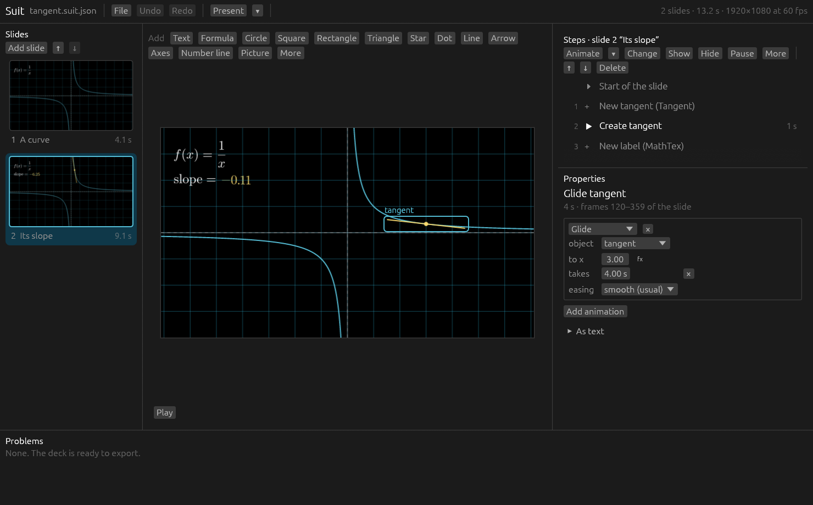
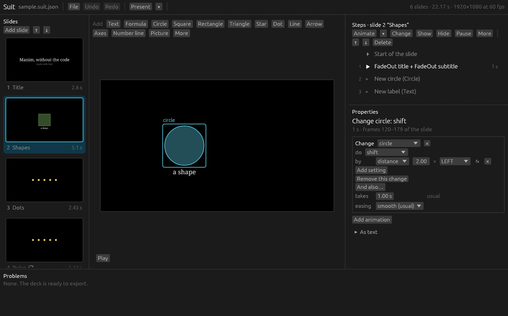

<p align="center">
  
</p>

<h1 align="center">Suit</h1>

**A visual editor for [Manim](https://www.manim.community/) slides.** Make animated
mathematical presentations by clicking instead of writing Python, and see every step
exactly as Manim draws it.



Manim makes beautiful mathematical animations, from code.
[manim-slides](https://manim-slides.eertmans.be/) turns them into slides, also from code.
Suit is the window on top: you put objects on a slide, say what happens to them step by
step, and present. The drawing is still done by Manim itself, so nothing you see is an
approximation.

## What it does

- **Objects by clicking**: text, LaTeX formulas, shapes, arrows, axes, pictures, groups.
- **Animations step by step**: 31 of Manim's animations, sorted by what they are for, with
  their length and easing. Drag an object on the canvas to move it.
- **Graphs that look before they draw**: type `1 / x` or `log(x)` and get the graph where
  the function has a value, with its asymptotes found for you.
- **Tangents** that touch a graph and glide along it, and numbers that show their slope.
  No derivative to work out.
- **Formulas instead of fixed values**: `2 * radius`, `circle.center + UP`,
  `tangent.slope`. Things can follow other things on every frame.
- **Mistakes found before they happen**: a checker reads the deck and reports what Manim
  would silently get wrong, such as animating something that is not on the slide, or a
  fill colour that nothing shows.
- **Present from the editor**, full screen, with the keys of manim-slides and your notes
  in a second window.
- **Export a website** of the talk: every slide rendered by Manim, played in any browser
  and on phones with the same keys as presenting, ready to put on Vercel, Netlify or
  GitHub Pages as it is.
- **Export a PDF**, a page per slide or per step, drawn as shapes so it is sharp at any
  zoom.
- **Export** ordinary Python for manim-slides, to render the talk yourself.
- **Undo for everything.**

## Get it running

There are three ways:

| Way | For |
|---|---|
| [An installer](#with-an-installer) | Windows, and Fedora Linux |
| [Docker](#with-docker) | Any system. Suit runs in your web browser. |
| [From the source](#without-docker-linux) | Linux, and people who want to change Suit |

### With an installer

The installers are on the [Releases page](https://github.com/M-Akram-H/Suit/releases).
They install Suit itself. Manim, which Suit draws with, is then set up for your user
account in one more step, which downloads about 300 MB.

**Windows 10 or 11**: `Suit-0.1.0-Setup.exe`

1. Run it. If Windows says *Windows protected your PC*, choose **More info** and then
   **Run anyway**: the installer is not signed.
2. On its last page, leave **Set up Manim now** ticked. A window installs Manim, and
   offers to install Python and LaTeX if they are missing.
3. Start **Suit** from the Start menu.

**Fedora**: `suit-0.1.0-1.fc44.x86_64.rpm`

```bash
sudo dnf install ./suit-0.1.0-1.fc44.x86_64.rpm
suit-setup
```

Then start **Suit** from the applications overview.

[Installing](docs/02-installing.md) says what each step does and where things go.

### With Docker

This is the way that works on **Linux, macOS and Windows** alike. Suit, Manim and LaTeX
run in a Docker container, and you use Suit in your web browser.

#### 1. Install two things

- **Git**: <https://git-scm.com/downloads>
- **Docker**: [Docker Desktop](https://www.docker.com/products/docker-desktop/) on Windows
  and macOS (start it and wait until it is running), or
  [Docker Engine](https://docs.docker.com/engine/install/) with the Compose plugin on Linux.

You need about 4 GB of free disk space.

#### 2. Get Suit and start it

Open a terminal (PowerShell on Windows) and run:

```bash
git clone https://github.com/M-Akram-H/Suit.git
cd Suit
docker compose up
```

The **first** start builds everything: it downloads Manim and LaTeX and compiles Suit.
That takes between fifteen and forty-five minutes, mostly depending on your internet
connection, and happens only once. Later starts take a few seconds.

#### 3. Open it

When the terminal prints

```
Suit is starting. Open http://localhost:6080 in a web browser.
```

open **<http://localhost:6080>** in your browser. You should see this, the editor with
its sample deck:



Click once inside the picture so that your keyboard goes to Suit. Then try it:

1. Press **Play** under the canvas to watch the first slide.
2. Click another slide on the left, and a step on the right, to look around.
3. Click **Text** in the bar above the canvas, and type. That is your first object.
4. Click **Present** to show the deck full screen; **→** is next, **Q** leaves.

#### 4. Your own decks

Save your decks into the folder the file browser opens in. On your computer that is the
**`decks`** folder inside the Suit folder, so your work stays when the container stops.

To stop Suit, press **Ctrl+C** in the terminal. To start it again, `docker compose up`.

Something not working? See [Troubleshooting](docs/15-troubleshooting.md).
More about the Docker setup, its settings, and updating: [Installing](docs/02-installing.md).

### Without Docker (Linux)

If you would rather have a real window, drawn by your graphics card, install Rust, Manim
and LaTeX yourself. On Ubuntu or Debian:

```bash
curl --proto '=https' --tlsv1.2 -sSf https://sh.rustup.rs | sh
sudo apt install build-essential pkg-config python3-dev python3-venv \
    libcairo2-dev libpango1.0-dev \
    texlive-latex-extra texlive-fonts-recommended texlive-science cm-super dvisvgm

git clone https://github.com/M-Akram-H/Suit.git
cd Suit
python3 -m venv .venv
.venv/bin/pip install -r requirements.txt
./run.sh
```

[Installing](docs/02-installing.md#without-docker-on-linux) has the details.

## Learn it

| | |
|---|---|
| [**Your first deck**](docs/03-first-deck.md) | Ten minutes from an empty deck to a presented one |
| [The window](docs/04-the-window.md) | Every panel, button and key |
| [Objects](docs/05-objects.md) · [Steps and animations](docs/06-steps-and-animations.md) | What can be on a slide, and what can happen to it |
| [Graphs and tangents](docs/07-graphs-and-tangents.md) · [Formulas](docs/08-formulas.md) | The mathematical side |
| [Slides and presenting](docs/09-slides-and-presenting.md) · [Saving and exporting](docs/10-saving-and-exporting.md) | Giving the talk |
| [Problems](docs/11-problems.md) · [Troubleshooting](docs/15-troubleshooting.md) | When something is wrong |
| [How it works](docs/12-how-it-works.md) · [The deck file](docs/13-deck-file-format.md) · [Developing](docs/14-developing.md) | The inside |
| [The specification](docs/spec/manim-core.md) | The formal definition of what a deck means |

All of it starts at [docs/README.md](docs/README.md).

## Decks written by Claude

This repository comes with a [Claude Code](https://claude.com/claude-code) skill,
[`.claude/skills/suit-slides`](.claude/skills/suit-slides/SKILL.md). Working in this
folder, ask Claude for slides ("make slides about eigenvalues for my first-year students")
and it writes a `.suit.json` deck, checks it with Suit's own checker, renders a preview
with Manim to look at the result, and hands you a file to open in Suit and polish.

## How it works, in one paragraph

A deck is a program in a small language, *Manim Core*, which has a written
[specification](docs/spec/manim-core.md). A checker reads the deck and works out, without
running anything, what exists at every step, what is wrong, and how long everything
takes to the frame. A code generator turns the deck into Python. To show the canvas, Suit
runs that Python in a real Manim in the background and asks what is on the scene after
every step, so the editor never has to imitate Manim. Suit is written in Rust, its window
with [egui](https://github.com/emilk/egui). [How it works](docs/12-how-it-works.md) tells
the whole story.

## Where it stands

Suit is at version 0.1. It works, and these are its edges:

- It has been built and tested on **Linux (x86-64)**: directly, in Docker, and from the
  Fedora package. The **Windows** installer is built on Linux and has been tried under
  Wine, where it installs and Suit starts; it has not been run on a real Windows PC yet.
  Docker on macOS, Windows and ARM is untried as well. Reports are welcome.
- It knows a catalogue of 32 kinds of object and 31 animations, not all of Manim. A
  *Python code* step covers the rest.
- Every edit takes a moment to show, because Manim is asked each time: up to about a
  second for the slide you are on, and longer until the slides after it are up to date.
- The deck's size, frame rate and background are set in the deck file, not in the window
  yet.
- The file format may still change.

Written against **Manim 0.21.0** and **manim-slides 5.7.0**.
