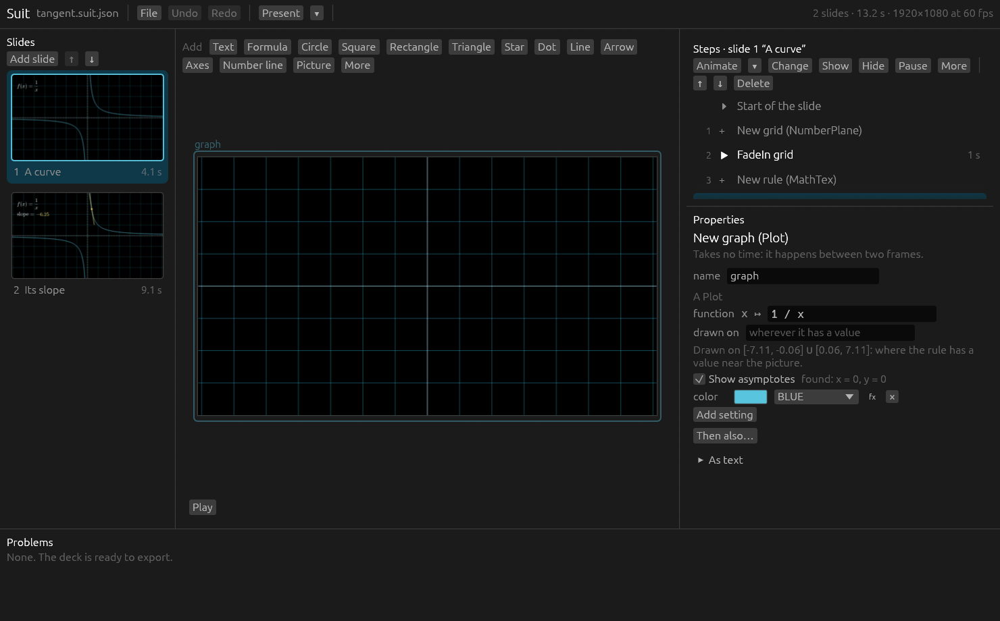

# 7. Graphs and tangents



## The graph of a function

**More → Graph of a function** draws a rule: for each `x`, a value. It starts as `sin(x)`
and the keyboard is in the rule, so type your own:

```
x ^ 2 / 4
1 / x
log(x)
sqrt(4 - x ^ 2)
if x > 0 then x else -x
```

The rule is a formula in `x` ([chapter 8](08-formulas.md)). It can use `sin`, `cos`,
`tan`, `exp`, `log`, `sqrt`, `abs`, `min`, `max`, `PI`, `TAU`, and any named value.

### Where the graph is drawn

Left alone, a graph is drawn **wherever its rule has a value**, across the width of the
frame. Suit looks before it draws:

- Where the rule has no value, like `log(x)` for negative `x`, nothing is drawn.
- Across a pole, like that of `1 / x` at 0, the two branches are drawn separately instead
  of being joined by a stroke from the bottom of the picture to the top.
- Where a branch runs off far beyond the frame, it is cut off.

Under the rule, Properties says what was found:
*Drawn on [-7.11, -0.06] ∪ [0.06, 7.11]: where the rule has a value near the picture.*

To draw only part of it, fill in **drawn on** with one or more stretches of the number
line:

```
[0, 3]
[-4, -0.5] ∪ [0.5, 4]
[-4; -0.5] union [0.5; 4]
```

A stretch is two numbers in square brackets, separated by a comma or a semicolon. Several
stretches are joined by `∪`, `U`, `union` or `or`. The ends can be formulas: `[0, 2 * PI]`.

If you ask for a stretch on which the rule has no value everywhere, Suit draws what it can
and says so in Problems, for example:
*The function “log(x)” is not defined on all of [-3, 3]. It is drawn where it has a value:
[0.01, 3].*

### Asymptotes

Suit finds the asymptotes by itself: the vertical ones, where the rule grows without end,
and the horizontal ones, which it settles on far out to either side. Properties lists them
(*found: x = 0, y = 0*), and **Show asymptotes** draws them as dashed grey lines.

They are found by trying numbers, not by algebra. An asymptote that the graph only reaches
far outside the frame, or a rule that behaves wildly, can be missed.

### Other settings

- **color**, **stroke width** and the like, as for any line ([chapter 5](05-objects.md#colours)).
- **step**: how finely the rule is tried, in units of `x`. The usual 0.02 is fine for
  smooth rules. Make it smaller for a rule with very sharp turns.
- **Then also…** to move or scale the finished graph.

### Units, and what to draw it on

A graph is drawn in the units of the scene: one unit of `x` is one unit to the right. A
**Grid** (under More) has its lines one unit apart, so a graph sits on it exactly.

**Axes** from the Add bar are Manim's `Axes`, which squeeze their ranges into a fixed
length: their ticks are *not* one scene unit apart, and a graph drawn next to them will
not line up with the ticks. Use a Grid as the background of a graph, or a
**Number line** with matching length.

The sample deck draws its sine wave the other way round, with Manim's own `FunctionGraph`
and a dot that is kept at `axes.c2p(t.value, sin(t.value))`: there the *axes* say where a
point of the rule is. That works for following a curve with a dot, but such a graph
cannot carry a tangent.

## Tangents

A tangent is a line that touches a graph at one point and has the graph's slope there.

1. Pick the graph. It has to be a *Graph of a function*.
2. **More → Tangent to a graph**.

The line appears in the middle of the longest piece of the graph, with a dot at the point
of contact.

| Setting | Meaning |
|---|---|
| **graph** | The graph it touches |
| **at x** | Where it touches |
| **length** | How long the line is, usually 3 |
| **mark the point** | Whether there is a dot at the point of contact |
| **color** | The colour of the line and the dot |

**Dragging** a tangent on the canvas slides it along its graph: only the `x` under the
pointer counts.

You never work out a derivative. Suit takes the slope from the graph's own rule, by
trying a tiny step to either side of the point.

### Moving it along the graph

Pick the tangent and choose **Animate ▾ → Change it → Glide**. Set **to x** to where it
should end up, and **takes** to how long that should last. While it glides, the line stays
tangent at every frame.

Dragging a tangent that has already been brought onto the slide offers the same:
**Glide there** adds the animation, **Jump there** moves it instantly.

> An ordinary *move* animation would carry the two ends of the line straight to their new
> places, and on the way the line would not touch the curve. That is why Glide exists.

A Glide across a pole, say from −1 to 1 on `1 / x`, takes the line off the picture and
back. Use two Glides, one on each branch, if that is not what you want.

A tangent put where its graph has no value has nothing to touch. Problems says so:
*“tangent” has nothing to touch: its graph has no value there.*

### Showing the slope

A tangent can be asked for its slope in any formula: `tangent.slope`. To show it as a
number that keeps up:

1. **More → Number**, and place it.
2. With the number picked, **More → Keep doing…** above the steps.
3. In Properties, set **do** to **set value**, press **fx** next to the number, and type
   `tangent.slope`.

From that step on the number shows the derivative at the point of contact, also while the
tangent glides. `examples/tangent.suit.json` does exactly this.


### If the graph is moved

A graph can be shifted and stretched like any object, with **Then also…** or with a
step. Its tangents go with it: they touch the graph where it is now. A graph that has been
*rotated* is the exception; its tangents do not follow the turn.

## Curves

**More → Curve** is for what is not the graph of a function: a point `(x, y)` that
depends on a number `t`. It starts as a circle, `(2 * cos(t), 2 * sin(t))` for `t` from 0
to τ. The rule is edited as a formula in `t`, and **t range** says from where to where,
in which steps.

Next: [8. Formulas](08-formulas.md)
