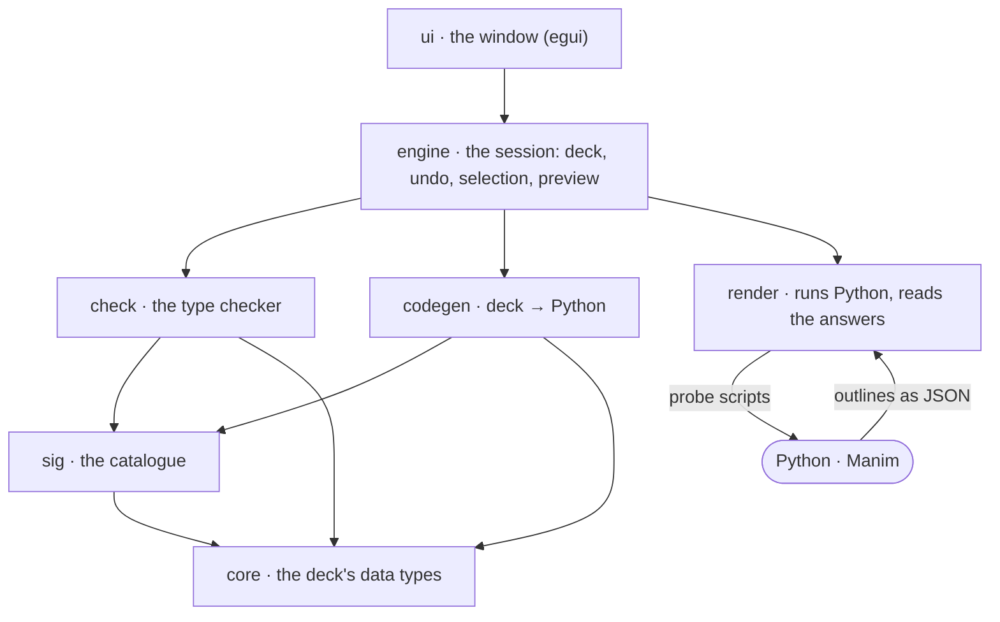

# 12. How it works

Suit is a Rust program that talks to a Python process running Manim. This chapter follows
a deck through the program: what each part does, and what passes between the parts.

## The idea: a small language with a definition

A deck is not a pile of widgets. It is a program in a small language called
**Manim Core**: slides are lists of commands, commands make objects and play animations.
The language has a written definition, [the specification](spec/manim-core.md), which
says what every construct means, which decks are well formed, and what Python each one
becomes.

Everything else follows from that:

- the **checker** implements the definition's typing rules;
- the **code generator** implements its translation to Python;
- the **editor** is a way of writing Manim Core by clicking;
- **Manim itself** is the reference for what the vocabulary draws.

## The parts

They are seven crates in `crates/`, and two programs in `apps/` (`suit`, the window, and
`suit-cli`, the command line).

| Crate | What it is | Spec |
|---|---|---|
| `core` | The data types of a deck: `Deck`, `Slide`, `Command`, `Object`, `Anim`, `Expr`. No behaviour, only the tree and its JSON form. | §3, §4 |
| `sig` | The **catalogue** (the *signature* Σ): which kinds of object exist and how they are related, which settings each takes, which methods, animations, easings, functions and constants there are. Data, not code. | §2 |
| `check` | The **checker**. Walks the deck once and works out, for every step, what exists and whether it is on the slide; reports errors and warnings; computes the exact length of every step and slide. | §5 |
| `codegen` | The **translation** to Python: the export, and the *probe* scripts the editor runs. Also the formula language people type. | §7, §3.1 |
| `render` | Manim as a **sidecar** process: starts Python, sends scripts, reads results, stops it when asked. | §2 |
| `engine` | The **session**: the open deck, every edit as an undoable change, the selection, and the preview kept in step with the deck. No user interface. | |
| `ui` | The **window**, drawn with egui. It changes nothing itself: every edit is a call into the session. | |

## What happens when you edit

Say you drag a circle.

1. **`ui`** turns the drag into a call on the session: *move this object to here*.
2. **`engine`** applies it as a change to the deck, records the old deck for Undo, and
   runs the checker.
3. **`check`** reads the whole deck again. It runs nothing, so this is quick enough to be
   done on every change. Its result holds the problems, the length of everything, and
   the objects that exist at each step.
4. **`engine`** asks for a new preview, in a background thread.
5. **`codegen`** writes a Python script for the slides that changed.
6. **`render`** sends it to the Python process, which runs it in Manim and writes back
   what is on the scene after each step.
7. **`ui`** draws that on the canvas.

Steps 1 to 3 happen within one frame, so the step list, the properties and the problems
are always current. Steps 4 to 7 take up to about a second for the slide you are on,
during which the canvas shows what it had; the slides after it follow in the background.

## Asking Manim: the probe

Suit never computes what Manim would draw. It asks.

A **probe** is the deck translated to Python as for an export, with two differences:
animations are not played but jumped to their end, and after every step a hook reports
the scene. For each object on the scene the report holds its outline as Bézier curves,
its colours, and which object of the deck it belongs to; for a picture, the image and its
corners. That is a few kilobytes of JSON per step.

The canvas draws these outlines itself (with tiny-skia). This is why the canvas can be
clicked and dragged: Suit knows which outline is which object.

### Keeping it fast

Starting Python and importing Manim takes a while, and running a whole deck takes longer
the longer the deck is. These keep an edit short:

- **One Python process stays alive.** It imports Manim once and then runs script after
  script.
- **Slides are run one at a time, and their starting points are kept.** Before each
  slide the Python side saves the whole state of the scene, under a key computed from
  everything that led up to it. After an edit, Suit works out the first slide whose key
  changed, and Manim starts from the saved state before that slide. The slide on the
  canvas is run first; the ones after it, which the change may have moved, follow, and
  are given up as soon as the deck changes again. A state is saved only once the scene
  moves on from it: while you type into a slide, every key starts again from the state
  before that slide, and the one after it would be out of date at once.
- **Animations whose end is plain are not run at all.** To skip an animation Manim still
  copies its objects several times over, and a text is made of many shapes. One that only
  brings an object in, takes it away, or points at it there and back, with an easing
  that ends where it should, leaves a scene Suit can set up itself. Everything else is
  run by Manim. A test runs decks both ways and compares every step; setting
  `SUIT_PROBE_EXACT=1` makes the probe run every animation.
- **Text is kept.** Formulas are typeset once and cached by Manim on disk, under Suit's
  cache folder. A `Text`, which Pango draws and Manim reads back curve by curve, takes a
  fifth of a second to make, and every edit makes the words of its slide again: the
  probe keeps each one it made, by what it was made from, and copies it the next time,
  which takes a hundredth.
- **Python's garbage collector waits.** It looks through every object there is each time
  enough new ones have been made, and restoring a slide's state makes hundreds of
  thousands. It runs between probes instead, while nothing is asked of Python.

A script that takes too long can be stopped: the Python side checks between steps
whether it is still wanted, and if it does not answer, the process is replaced.

### Playing: recordings

To play a slide, Suit needs every frame, not every step. A second kind of probe runs one
slide with its animations really playing, and reports the outlines of every frame. That
is a **recording**. It is drawn the same way as a step.

Recordings are made in the background when the deck has been left alone for a moment,
one slide after another, and are kept under the same keys as the saved states. Play and
Present use them. A slide that is not recorded yet is waited for.

### What Manim adds to the problems

While it runs a deck, the Python side notices things only Manim can know, and reports
them as *remarks*: an object with points that are not numbers, a graph asked to draw
where its rule has no value, a tangent with nothing to touch. The engine puts them into
words and lists them with the checker's findings.

## Suit's own objects

Two things in the catalogue are not Manim's: `Plot`, the graph that looks before it
draws, and `Tangent` with its animation `Glide`. They are written in Python
(`crates/codegen/src/plot.py`, `tangent.py`), a few hundred lines together. The probe
scripts always carry them, and an export carries them when the deck uses them, so an
exported file needs nothing but Manim.

## Being sure

Much of Suit is there to make sure the three views of a deck agree: what the checker
predicts, what the canvas shows, and what manim-slides renders.

- **The catalogue is checked against Manim.** `tools/check_catalog.py` loads the
  installed Manim and verifies every kind, setting, default length and constant in the
  catalogue: about 700 facts. A typing mistake in the catalogue fails this check, not a
  render months later.
- **The timing is checked against renders.** The checker says how many frames each slide
  has. The tests render decks with manim-slides and count the frames in the videos.
- **The preview is checked against itself.** A deck edited many times, with undo, must
  give the same pictures as the same deck run from scratch.
- **The window is tested as a person uses it**: by simulated clicks, keys and drags
  (`crates/ui/tests/interaction.rs`), and by a script that drives the real window on a
  hidden display (`tools/smoke.sh`).

[Chapter 14](14-developing.md) says how to run all of these.

## Where things are kept

| What | Where |
|---|---|
| The deck | The `.suit.json` file you save |
| Undo history, selection, recordings | In memory, for the session |
| Manim's typeset texts and formulas, the scripts in flight | `~/.cache/suit` (or `$XDG_CACHE_HOME/suit`). Safe to delete. |
| Settings | None are kept: Suit has no settings file. |

Next: [13. The deck file](13-deck-file-format.md)
